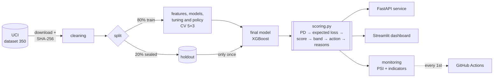

# Cost-Driven Credit Risk


[:fontawesome-brands-github: Repository](https://github.com/RToyoyama/credit-risk-semantix){ .md-button .md-button--primary }
[:material-monitor-dashboard: Live dashboard](https://credit-risk-semantix-vsjmawoelrtyrwzz49nnaa.streamlit.app/){ .md-button }

---

## Overview

An **EBAC × Semantix** partnership project. A system that helps a credit card
issuer decide, every month, **which customers to act on before they stop paying**,
choosing by **the money at stake** rather than by hit rate.

22% of customers in the dataset default on their next bill, and the team can only
handle **10% of the portfolio per month**. The question is: **which 10%?**

Result on the sealed final test (**6,000 customers the model never saw**, used only once):

| Who to act on (600 customers) | Net value (avoided loss − costs) |
|---|---|
| Nobody | NT$ 0 (the NT$ 40.4M loss remains in full) |
| Delinquency rule (most overdue first, no model) | NT$ 5.17M |
| **Highest expected value (model)** | **NT$ 7.52M** |

**+NT$ 2.36 million (+46%) over the delinquency rule** (95% CI: +1.59 to +3.15M).
On training data, the model beats the rule in **12 of 12** business-assumption scenarios.

!!! success "Highlights"
    - **Cost-based decisions, not accuracy:** per-customer expected loss (PD × LGD × EAD) defines who to act on. Ranking by default probability alone **ties with the delinquency rule**; the gain comes from combining probability with how much the customer owes
    - **A truly sealed holdout:** 20% set aside on day one and evaluated once — CV predicted the holdout (PR AUC 0.566 → 0.560)
    - **Complete policy:** 0–1000 score, monotonic A–E bands (6% → 71% default), per-decision reason codes via TreeSHAP and monthly monitoring
    - **End-to-end product:** FastAPI service, 7-page Streamlit dashboard with simulators, monthly monitoring job on GitHub Actions
    - **Fairness:** the model drops sex, marital status and age with no loss in performance; PD error is at most 2.0 p.p. in any group
    - **Reproducible:** data SHA-256, locked dependencies, Docker reproducing holdout metrics with a 0.0 difference, 215 tests and CI

---

## Architecture



API, dashboard and evaluation all go through the same `scoring.py`: each business
rule lives in **exactly one place**.

---

## The Data

*Default of Credit Card Clients* (Yeh & Lien, 2009), from the
[UCI Machine Learning Repository](https://archive.ics.uci.edu/dataset/350/default+of+credit+card+clients)
(CC BY 4.0): **30,000 customers** of a Taiwanese bank (Apr–Sep 2005), with credit
limit, profile and 6 months of payment status, bill and payment history. Target:
default in October 2005 (22.12% positive).

---

## Tech Stack

| Technology | Role |
|---|---|
| Python 3.11 | Main language |
| pandas / NumPy | Data manipulation and feature engineering |
| SciPy / statsmodels | Inference: bootstrap CIs, chi-square, Mann-Whitney, Holm |
| scikit-learn | Pipelines, PCA, K-means, CV, tuning, calibration and ensembles |
| XGBoost | Final model |
| imbalanced-learn | Class balancing experiment (SMOTE) |
| SHAP | Per-customer reason codes (TreeSHAP) |
| FastAPI / pydantic | Scoring API with a strict contract |
| Streamlit / Plotly | Storytelling dashboard and simulators |
| pytest / ruff / pre-commit | Testing and code quality |
| Docker / Compose / GitHub Actions | Reproduction, local deploy, CI and monthly monitoring |

---

## Methodology

1. **EDA with inference:** bootstrap CIs, tests with effect sizes and Holm correction. Recent delinquency is the strongest signal — with 2 months overdue in September, **69%** defaulted. The analysis also showed that code `-2` means "paid the bill in full", not "no usage".
2. **Segmentation (PCA + K-means, without the target):** three profiles — full payers (16.7% default), revolvers in good standing (18.8%) and chronic delinquents (**62.4%**).
3. **Model duel:** logistic regression × Decision Tree × Random Forest × XGBoost with 5×3 `RepeatedStratifiedKFold` and paired comparison. Imbalance-aware metrics: PR AUC, ROC AUC, KS and Brier.
4. **Experiments with criteria fixed upfront:** balancing, ensembles, calibration and segment-as-feature were tested and rejected — a simpler final system, XGBoost alone.
5. **Cost-based policy:** per-customer expected loss, with threshold and band cutoffs set on out-of-fold training predictions, plus sensitivity analysis on assumptions (LGD, action effectiveness, costs).
6. **Single holdout evaluation**, portfolio expected loss, score and bands, per-customer reasons and fairness audit.
7. **Monitoring:** PSI on the score and features + business indicators, validated against a simulated crisis.


---

## Results

### Final test (holdout, 6,000 customers)

| Metric | Holdout | 95% CI | CV (train) |
|---|---|---|---|
| PR AUC | **0.560** | 0.531 – 0.589 | 0.566 |
| ROC AUC | 0.782 | 0.767 – 0.796 | 0.788 |
| KS | 0.427 | 0.402 – 0.457 | 0.441 |
| Brier | 0.134 | 0.129 – 0.140 | 0.133 |

Without a model, PR AUC would be 0.22. The predicted portfolio expected loss
(NT$ 39.4M) landed within **2.3%** of the actual loss (NT$ 40.4M).

### Risk bands (holdout)

| Band | Customers | Default rate | Action |
|---|---|---|---|
| A | 1,787 | 6.3% | eligible for limit increases and offers |
| B | 1,540 | 14.2% | standard relationship |
| C | 1,213 | 20.0% | standard relationship, monitored |
| D | 842 | 38.0% | close monitoring |
| E | 618 | **70.4%** | priority candidate for preventive action |

Each decision comes with its **top 3 reasons** as business sentences, e.g.
"2 months overdue on the last payment · overdue in 1 of the last 6 months · uses 98% of the limit".

### What didn't work (and became a lesson)

| Experiment | Result |
|---|---|
| Ranking by highest default probability | NT$ 5.01M — ties with the delinquency rule; the amount at stake is what makes the difference |
| Balancing, ensembles and calibration | Rejected by criteria set beforehand |
| PSI as the only drift alarm | Missed a simulated crisis; mean PD and band-E share caught it |


!!! info "Lessons learned"
    - **A truly sealed test builds confidence.** On Titanic, CV said 0.85 and reality was 0.78; here the gap was 0.006.
    - **The goal is money, not a metric.** The best risk model tied with a simple rule until the amount at stake came in.
    - **Fixing criteria upfront prevents self-deception** — and keeps the system simpler.
    - **Distrust the data documentation:** code `-2` did not mean what is commonly assumed.
    - **Looking at the product catches bugs tests miss:** dashboard screenshots revealed a wrong calculation.

!!! warning "Limitations"
    Data from 2005, from a single Taiwanese bank, with no income or credit bureau data.
    Business assumptions (60% loss given default, 30% action effectiveness, costs) are
    references, not measurements — the conclusion holds across them, but the monetary
    value depends on them.

---

## How to Run

=== "Docker"

    ```bash
    git clone https://github.com/RToyoyama/credit-risk-semantix.git
    cd credit-risk-semantix
    make up        # or: docker compose up -d
    ```

    On first run, the API downloads the UCI data and trains the model (~1 minute).
    API at `http://localhost:8000/docs` and dashboard at `http://localhost:8501`.

=== "Local"

    ```bash
    git clone https://github.com/RToyoyama/credit-risk-semantix.git
    cd credit-risk-semantix
    make venv && make install
    make data         # download from UCI and verify SHA-256
    make split        # cleaning + holdout
    make experiments  # experiments → reports/
    make final        # single holdout evaluation
    make api          # API on :8000
    make app          # dashboard on :8501
    make test
    ```

### Example: calling the API

```bash
curl -X POST http://localhost:8000/score -H "Content-Type: application/json" -d '{
  "id": 101, "limit_bal": 50000, "education": 2,
  "pay_status_1": 2, "pay_status_2": 2, "pay_status_3": 0, "pay_status_4": 0, "pay_status_5": 0, "pay_status_6": 0,
  "bill_amt_1": 48500, "bill_amt_2": 47000, "bill_amt_3": 46200, "bill_amt_4": 30000, "bill_amt_5": 28000, "bill_amt_6": 25000,
  "pay_amt_1": 0, "pay_amt_2": 1500, "pay_amt_3": 2000, "pay_amt_4": 1500, "pay_amt_5": 1000, "pay_amt_6": 1000
}'
```

```json
{
  "pd": 0.611, "score": 352, "faixa": "E",
  "acao": "candidato prioritário a ação preventiva", "prioritario": true,
  "perda_esperada": 17783.42,
  "motivos": [
    "2 meses de atraso no último pagamento",
    "atraso em 2 dos últimos 6 meses (pior atraso: 2 meses)",
    "comportamento de pagamento: pagou 0% da fatura anterior"
  ]
}
```

The API **rejects** sex, marital status and age — sending any of them returns a 422 error.

!!! note
    The notebooks, documentation, dashboard and API responses are in Portuguese.
