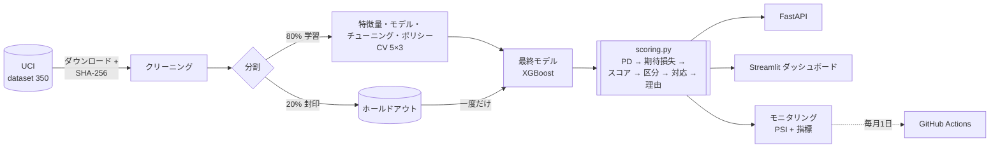

# コスト重視の信用リスク


[:fontawesome-brands-github: リポジトリ](https://github.com/RToyoyama/credit-risk-semantix){ .md-button .md-button--primary }
[:material-monitor-dashboard: オンラインダッシュボード](https://credit-risk-semantix-vsjmawoelrtyrwzz49nnaa.streamlit.app/){ .md-button }

---

## 概要

**EBAC × Semantix** の提携プロジェクト。クレジットカード会社が毎月、
**支払いが滞る前にどの顧客へ対応すべきか**を、的中率ではなく
**懸かっている金額**で判断するためのシステムです。

データの顧客の22%が翌月の請求を支払わず、チームが対応できるのは
**毎月ポートフォリオの10%のみ**。問題は「**どの10%か？**」です。

封印された最終テスト（**モデルが一度も見ていない6,000人**、一度だけ使用）での結果：

| 対応する顧客（600人） | 純価値（回避した損失 − コスト） |
|---|---|
| 誰にも対応しない | NT$ 0（NT$ 4,040万の損失がそのまま残る） |
| 延滞ルール（延滞が長い順、モデルなし） | NT$ 517万 |
| **期待価値が最も高い顧客（モデル）** | **NT$ 752万** |

**延滞ルールより +NT$ 236万（+46%）**（95%信頼区間：+159万〜+315万）。
学習データでは、ビジネス前提の **12通りすべて** のシナリオでモデルがルールを上回りました。

!!! success "ハイライト"
    - **正解率ではなくコストで判断：** 顧客ごとの期待損失（PD × LGD × EAD）で対応先を決定。デフォルト確率だけで選ぶと**延滞ルールと同等**にとどまり、確率と債務額を組み合わせて初めて利益が生まれる
    - **本当に封印されたホールドアウト：** 初日に20%を分離し一度だけ評価 — CVがホールドアウトを正確に予測（PR AUC 0.566 → 0.560）
    - **完全な与信ポリシー：** 0〜1000のスコア、単調なA〜E区分（デフォルト率 6% → 71%）、TreeSHAPによる判断理由、月次モニタリング
    - **エンドツーエンドのプロダクト：** FastAPI、シミュレーター付き7ページのStreamlitダッシュボード、GitHub Actionsによる月次モニタリング
    - **公平性：** 性別・婚姻状況・年齢を使わなくても性能は変わらず、どのグループでもPDの誤差は最大2.0ポイント
    - **再現性：** データのSHA-256検証、依存関係のロック、Dockerでホールドアウト指標を差0.0で再現、215件のテストとCI

---

## アーキテクチャ



API、ダッシュボード、評価はすべて同じ `scoring.py` を通るため、
各ビジネスルールは**一か所にだけ**存在します。

---

## データ

*Default of Credit Card Clients*（Yeh & Lien, 2009）、
[UCI Machine Learning Repository](https://archive.ics.uci.edu/dataset/350/default+of+credit+card+clients)
（CC BY 4.0）：台湾の銀行の**顧客30,000人**（2005年4〜9月）。与信枠、属性、
6か月分の支払状況・請求額・支払額。目的変数：2005年10月のデフォルト（陽性22.12%）。

---

## 使用技術

| 技術 | 役割 |
|---|---|
| Python 3.11 | メイン言語 |
| pandas / NumPy | データ操作と特徴量エンジニアリング |
| SciPy / statsmodels | 推測統計：ブートストラップ信頼区間、カイ二乗検定、Mann-Whitney、Holm補正 |
| scikit-learn | パイプライン、PCA、K-means、CV、チューニング、キャリブレーション、アンサンブル |
| XGBoost | 最終モデル |
| imbalanced-learn | クラス不均衡の実験（SMOTE） |
| SHAP | 顧客ごとの判断理由（TreeSHAP） |
| FastAPI / pydantic | 厳格な入力契約を持つスコアリングAPI |
| Streamlit / Plotly | ストーリーテリング型ダッシュボードとシミュレーター |
| pytest / ruff / pre-commit | テストとコード品質 |
| Docker / Compose / GitHub Actions | 再現、ローカルデプロイ、CIと月次モニタリング |

---

## 手法

1. **推測統計を用いたEDA：** ブートストラップ信頼区間、効果量付きの検定、Holm補正。直近の延滞が最も強いシグナルで、9月に2か月延滞した顧客の **69%** がデフォルト。また、コード `-2` は「利用なし」ではなく「全額返済」を意味することを確認しました。
2. **セグメンテーション（PCA + K-means、目的変数なし）：** 全額返済層（デフォルト率16.7%）、正常なリボ利用層（18.8%）、慢性延滞層（**62.4%**）の3タイプ。
3. **モデル対決：** ロジスティック回帰 × 決定木 × ランダムフォレスト × XGBoost を5×3の `RepeatedStratifiedKFold` と対応比較で評価。不均衡データ向けの指標：PR AUC、ROC AUC、KS、Brier。
4. **事前に基準を決めた実験：** 不均衡対策、アンサンブル、キャリブレーション、セグメントの特徴量化を検証し不採用 — 最終システムはXGBoost単体のシンプルな構成。
5. **コストに基づくポリシー：** 顧客ごとの期待損失。閾値と区分の境界は学習データのout-of-fold予測で決定し、前提（LGD、対応の効果、コスト）への感度分析も実施。
6. **ホールドアウトでの一度きりの評価**、ポートフォリオ期待損失、スコアと区分、顧客ごとの理由、公平性監査。
7. **モニタリング：** スコアと特徴量のPSI + ビジネス指標。模擬的な危機で検証。


---

## 結果

### 最終テスト（ホールドアウト、6,000人）

| 指標 | ホールドアウト | 95%信頼区間 | CV（学習） |
|---|---|---|---|
| PR AUC | **0.560** | 0.531 – 0.589 | 0.566 |
| ROC AUC | 0.782 | 0.767 – 0.796 | 0.788 |
| KS | 0.427 | 0.402 – 0.457 | 0.441 |
| Brier | 0.134 | 0.129 – 0.140 | 0.133 |

モデルなしのPR AUCは0.22。予測したポートフォリオ期待損失（NT$ 3,940万）は
実際の損失（NT$ 4,040万）との差が **2.3%** でした。

### リスク区分（ホールドアウト）

| 区分 | 顧客数 | デフォルト率 | 対応 |
|---|---|---|---|
| A | 1,787 | 6.3% | 与信枠引き上げ・特典の対象 |
| B | 1,540 | 14.2% | 通常対応 |
| C | 1,213 | 20.0% | 通常対応＋モニタリング |
| D | 842 | 38.0% | 重点モニタリング |
| E | 618 | **70.4%** | 予防的対応の最優先候補 |

各判断にはビジネス用語での**主な理由3つ**が付きます。例：
「直近の支払いが2か月延滞 · 過去6か月中1か月延滞 · 与信枠の98%を利用」。

### うまくいかなかったこと（そして得た教訓）

| 実験 | 結果 |
|---|---|
| デフォルト確率の高い順に選ぶ | NT$ 501万 — 延滞ルールと同等。差を生むのは懸かっている金額 |
| 不均衡対策、アンサンブル、キャリブレーション | 事前に決めた基準により不採用 |
| ドリフト警報をPSIだけに頼る | 模擬危機を検知できず、平均PDと区分Eの割合は検知 |


!!! info "学んだこと"
    - **本当に封印されたテストは信頼を生む。** タイタニックではCV 0.85が実際には0.78でしたが、今回の差は0.006。
    - **目的は指標ではなくお金。** 最良のリスクモデルも、懸かっている金額を加えるまでは単純なルールと同等でした。
    - **基準を先に決めると自己欺瞞を防げる** — そしてシステムがシンプルになる。
    - **データのドキュメントを疑う：** コード `-2` は一般的に想定される意味ではありませんでした。
    - **プロダクトを見るとテストで見逃すバグが見つかる：** ダッシュボードのスクリーンショットで計算ミスを発見。

!!! warning "制約"
    データは2005年、台湾の一つの銀行のもので、収入や信用情報機関のデータはありません。
    ビジネス前提（デフォルト時損失率60%、対応の効果30%、コスト）は参考値であり実測値ではありません。
    結論はこれらの前提に対して頑健ですが、金額はそれに依存します。

---

## 実行方法

=== "Docker"

    ```bash
    git clone https://github.com/RToyoyama/credit-risk-semantix.git
    cd credit-risk-semantix
    make up        # または: docker compose up -d
    ```

    初回はAPIがUCIからデータをダウンロードしモデルを学習します（約1分）。
    API：`http://localhost:8000/docs`、ダッシュボード：`http://localhost:8501`。

=== "ローカル"

    ```bash
    git clone https://github.com/RToyoyama/credit-risk-semantix.git
    cd credit-risk-semantix
    make venv && make install
    make data         # UCIからダウンロードしSHA-256を検証
    make split        # クリーニング + ホールドアウト
    make experiments  # 実験 → reports/
    make final        # ホールドアウトで一度だけ評価
    make api          # API :8000
    make app          # ダッシュボード :8501
    make test
    ```

### 例：APIの呼び出し

```bash
curl -X POST http://localhost:8000/score -H "Content-Type: application/json" -d '{
  "id": 101, "limit_bal": 50000, "education": 2,
  "pay_status_1": 2, "pay_status_2": 2, "pay_status_3": 0, "pay_status_4": 0, "pay_status_5": 0, "pay_status_6": 0,
  "bill_amt_1": 48500, "bill_amt_2": 47000, "bill_amt_3": 46200, "bill_amt_4": 30000, "bill_amt_5": 28000, "bill_amt_6": 25000,
  "pay_amt_1": 0, "pay_amt_2": 1500, "pay_amt_3": 2000, "pay_amt_4": 1500, "pay_amt_5": 1000, "pay_amt_6": 1000
}'
```

```json
{
  "pd": 0.611, "score": 352, "faixa": "E",
  "acao": "candidato prioritário a ação preventiva", "prioritario": true,
  "perda_esperada": 17783.42,
  "motivos": [
    "2 meses de atraso no último pagamento",
    "atraso em 2 dos últimos 6 meses (pior atraso: 2 meses)",
    "comportamento de pagamento: pagou 0% da fatura anterior"
  ]
}
```

APIは性別・婚姻状況・年齢を**受け付けません** — いずれかを送ると422エラーになります。

!!! note
    ノートブック、ドキュメント、ダッシュボード、APIのレスポンスはポルトガル語です。
