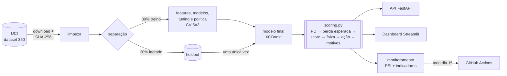

# Risco de Crédito Orientado a Custo


[:fontawesome-brands-github: Repositório](https://github.com/RToyoyama/credit-risk-semantix){ .md-button .md-button--primary }
[:material-monitor-dashboard: Dashboard online](https://credit-risk-semantix-vsjmawoelrtyrwzz49nnaa.streamlit.app/){ .md-button }

---

## Visão Geral

Projeto de parceria **EBAC × Semantix**. Um sistema que ajuda uma emissora de
cartão de crédito a decidir, todo mês, **em quais clientes agir antes que eles
deixem de pagar**, escolhendo pelo **dinheiro em jogo**, e não pela taxa de acerto.

22% dos clientes da base deixam de pagar a fatura seguinte, e a equipe só consegue
atender **10% da carteira por mês**. A pergunta é: **quais 10%?**

Resultado na prova final lacrada (**6.000 clientes que o modelo nunca viu**, usada uma única vez):

| Quem acionar (600 clientes) | Valor líquido (perda evitada − custos) |
|---|---|
| Ninguém | NT$ 0 (a perda de NT$ 40,4 mi segue inteira) |
| Regra de atraso (os mais atrasados primeiro, sem modelo) | NT$ 5,17 mi |
| **Os de maior valor esperado (modelo)** | **NT$ 7,52 mi** |

**+NT$ 2,36 milhões (+46%) a mais que a regra de atraso** (IC 95%: +1,59 a +3,15 mi).
No treino, o modelo vence a regra em **12 de 12** cenários de premissas de negócio.

!!! success "Destaques"
    - **Decisão por custo, não por acurácia:** perda esperada por cliente (PD × LGD × EAD) define quem acionar. Escolher só pela probabilidade de calote **empata com a regra de atraso**; o ganho vem de combinar a probabilidade com quanto o cliente deve
    - **Holdout lacrado de verdade:** 20% separados no primeiro dia e avaliados uma única vez — a CV previu o holdout (PR AUC 0,566 → 0,560)
    - **Política completa:** score 0–1000, faixas A–E monotônicas (6% → 71% de calote), motivos de cada decisão via TreeSHAP e monitoramento mensal
    - **Produto de ponta a ponta:** API FastAPI, dashboard Streamlit com 7 páginas e simuladores, job mensal de monitoramento no GitHub Actions
    - **Equidade:** o modelo dispensa sexo, estado civil e idade sem perder desempenho; a PD erra no máximo 2,0 p.p. em qualquer grupo
    - **Reprodutível:** SHA-256 dos dados, lock de dependências, Docker reproduzindo as métricas do holdout com diferença 0,0, 215 testes e CI

---

## Arquitetura



API, dashboard e avaliação passam pelo mesmo `scoring.py`: cada regra de negócio
existe em **um só lugar**.

---

## Os Dados

*Default of Credit Card Clients* (Yeh & Lien, 2009), do
[UCI Machine Learning Repository](https://archive.ics.uci.edu/dataset/350/default+of+credit+card+clients)
(CC BY 4.0): **30.000 clientes** de um banco de Taiwan (abr–set/2005), com limite,
perfil e 6 meses de histórico de pagamento, fatura e valor pago. Alvo: calote em
outubro de 2005 (22,12% positivos).

---

## Stack Utilizada

| Tecnologia | Função |
|---|---|
| Python 3.11 | Linguagem principal |
| pandas / NumPy | Manipulação dos dados e feature engineering |
| SciPy / statsmodels | Inferência: IC bootstrap, qui-quadrado, Mann-Whitney, Holm |
| scikit-learn | Pipelines, PCA, K-means, CV, tuning, calibração e ensembles |
| XGBoost | Modelo final |
| imbalanced-learn | Experimento de balanceamento (SMOTE) |
| SHAP | Motivos da decisão por cliente (TreeSHAP) |
| FastAPI / pydantic | API de scoring com contrato estrito |
| Streamlit / Plotly | Dashboard de storytelling e simuladores |
| pytest / ruff / pre-commit | Testes e qualidade de código |
| Docker / Compose / GitHub Actions | Reprodução, deploy local e CI + monitoramento mensal |

---

## Metodologia

1. **EDA com inferência:** IC bootstrap, testes com tamanho de efeito e correção de Holm. O atraso recente é o sinal mais forte — com 2 meses de atraso em setembro, **69%** deram calote. A análise também mostrou que o código `-2` significa "quitou a fatura", não "sem consumo".
2. **Segmentação (PCA + K-means, sem o alvo):** três perfis — quitadores (16,7% de calote), rotativo em dia (18,8%) e atraso crônico (**62,4%**).
3. **Duelo de modelos:** regressão logística × Árvore de Decisão × Random Forest × XGBoost com `RepeatedStratifiedKFold` 5×3 e comparação pareada. Métricas adequadas ao desbalanceamento: PR AUC, ROC AUC, KS e Brier.
4. **Experimentos com critério fixado antes:** balanceamento, ensembles, calibração e segmento como feature foram testados e rejeitados — sistema final mais simples, XGBoost sozinho.
5. **Política por custo:** perda esperada por cliente, limiar e cortes das faixas definidos nas previsões out-of-fold do treino, com análise de sensibilidade às premissas (LGD, eficácia da ação, custos).
6. **Avaliação única no holdout**, perda esperada da carteira, score e faixas, motivos por cliente e auditoria de equidade.
7. **Monitoramento:** PSI do score e das variáveis + indicadores de negócio, validado com uma crise simulada.


---

## Resultados

### Prova final (holdout, 6.000 clientes)

| Métrica | Holdout | IC 95% | CV (treino) |
|---|---|---|---|
| PR AUC | **0,560** | 0,531 – 0,589 | 0,566 |
| ROC AUC | 0,782 | 0,767 – 0,796 | 0,788 |
| KS | 0,427 | 0,402 – 0,457 | 0,441 |
| Brier | 0,134 | 0,129 – 0,140 | 0,133 |

Sem modelo, a PR AUC seria 0,22. A perda esperada prevista para a carteira
(NT$ 39,4 mi) ficou a **2,3%** da perda real (NT$ 40,4 mi).

### Faixas de risco (holdout)

| Faixa | Clientes | Taxa de calote | Ação |
|---|---|---|---|
| A | 1.787 | 6,3% | elegível a aumento de limite e ofertas |
| B | 1.540 | 14,2% | relacionamento padrão |
| C | 1.213 | 20,0% | relacionamento padrão, com monitoramento |
| D | 842 | 38,0% | monitoramento próximo |
| E | 618 | **70,4%** | candidato prioritário a ação preventiva |

Cada decisão vem com os **3 principais motivos** em frases de negócio, por exemplo:
"2 meses de atraso no último pagamento · atraso em 1 dos últimos 6 meses · usa 98% do limite".

### O que não funcionou (e virou aprendizado)

| Experimento | Resultado |
|---|---|
| Escolher pela maior probabilidade de calote | NT$ 5,01 mi — empata com a regra de atraso; o valor em jogo é o que faz diferença |
| Balanceamento, ensemble e calibração | Rejeitados pelos critérios fixados antes |
| PSI como único alarme de drift | Não percebeu uma crise simulada; PD média e participação da faixa E perceberam |


!!! info "Lições aprendidas"
    - **Uma prova lacrada de verdade dá confiança.** No Titanic, a CV dizia 0,85 e a realidade foi 0,78; aqui a diferença foi 0,006.
    - **O objetivo é dinheiro, não métrica.** O melhor modelo de risco empatou com uma regra simples até entrar o valor em jogo.
    - **Fixar o critério antes evita se enganar** — e deixa o sistema mais simples.
    - **Desconfiar da documentação dos dados:** o código `-2` não significava o que se costuma supor.
    - **Olhar o produto pega erros que os testes não pegam:** as capturas do dashboard revelaram um cálculo errado.

!!! warning "Limitações"
    Dados de 2005, de um único banco de Taiwan, sem renda nem dados de birô. As premissas
    de negócio (perda de 60% no calote, eficácia da ação de 30%, custos) são referências,
    não medições — a conclusão resiste a elas, mas o valor em dinheiro depende delas.

---

## Como Executar

=== "Docker"

    ```bash
    git clone https://github.com/RToyoyama/credit-risk-semantix.git
    cd credit-risk-semantix
    make up        # ou: docker compose up -d
    ```

    Na primeira vez, a API baixa os dados da UCI e treina o modelo (~1 minuto).
    API em `http://localhost:8000/docs` e dashboard em `http://localhost:8501`.

=== "Local"

    ```bash
    git clone https://github.com/RToyoyama/credit-risk-semantix.git
    cd credit-risk-semantix
    make venv && make install
    make data         # baixa da UCI e confere o SHA-256
    make split        # limpeza + holdout
    make experiments  # experimentos → reports/
    make final        # avaliação única no holdout
    make api          # API em :8000
    make app          # dashboard em :8501
    make test
    ```

### Exemplo: chamando a API

```bash
curl -X POST http://localhost:8000/score -H "Content-Type: application/json" -d '{
  "id": 101, "limit_bal": 50000, "education": 2,
  "pay_status_1": 2, "pay_status_2": 2, "pay_status_3": 0, "pay_status_4": 0, "pay_status_5": 0, "pay_status_6": 0,
  "bill_amt_1": 48500, "bill_amt_2": 47000, "bill_amt_3": 46200, "bill_amt_4": 30000, "bill_amt_5": 28000, "bill_amt_6": 25000,
  "pay_amt_1": 0, "pay_amt_2": 1500, "pay_amt_3": 2000, "pay_amt_4": 1500, "pay_amt_5": 1000, "pay_amt_6": 1000
}'
```

```json
{
  "pd": 0.611, "score": 352, "faixa": "E",
  "acao": "candidato prioritário a ação preventiva", "prioritario": true,
  "perda_esperada": 17783.42,
  "motivos": [
    "2 meses de atraso no último pagamento",
    "atraso em 2 dos últimos 6 meses (pior atraso: 2 meses)",
    "comportamento de pagamento: pagou 0% da fatura anterior"
  ]
}
```

A API **não aceita** sexo, estado civil nem idade — enviar um deles retorna erro 422.
